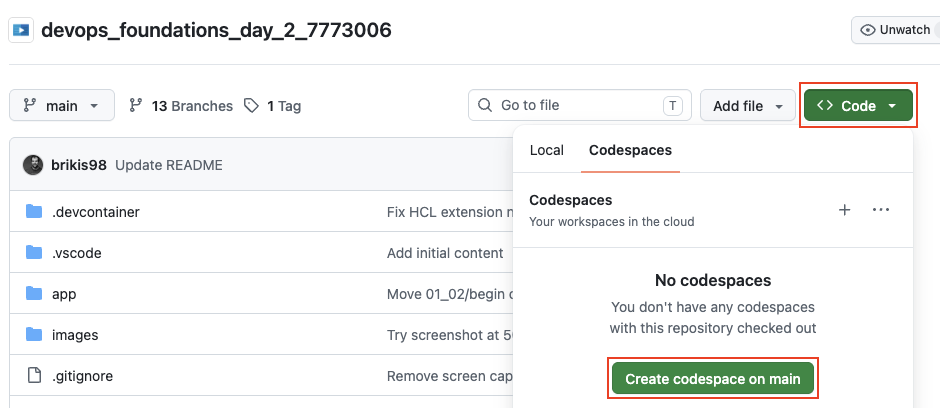
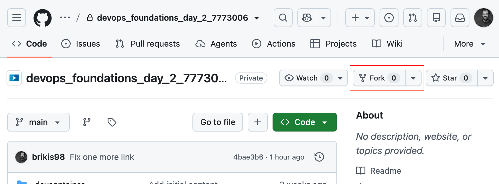

# DevOps Foundations Day 2

This is the repository for the LinkedIn Learning course `DevOps Foundations Day 2`. The full course is available from
[LinkedIn Learning][lil-course-url].

![course-name-alt-text][lil-thumbnail-url]

## Course description
Explore the critical "Day 2" operations skills needed for maintaining, scaling, and operating production systems through "DevOps Foundations". Learn how to manage infrastructure as code using vital tools like Terraform and OpenTofu, ensuring your deployment process is automated and reliable. Delve into establishing effective observability to troubleshoot and resolve issues swiftly using metrics and logging tools like Datadog and CloudWatch. Learn about the importance of maintaining secure environments through private networking, data encryption, and continuous integration and delivery commands using GitOps practices. Targeted at software engineers, operations professionals, and technical leads, this course is ideal for anyone who manages production systems and desires to elevate their DevOps skills. Instructed by industry expert Jim Brikman, this course provides real-world, hands-on learning examples to deepen understanding. By concluding the course, you'll be more prepared to seamlessly integrate DevOps principles into your operations, fostering rapid and reliable software delivery in any organizational setting. Whether you're a developer or manager, advancing your knowledge of Day 2 operations will be invaluable in achieving peak operational efficiency.

## Learning objectives
- Explain core DevOps principles and their role in modern software delivery.
- Identify how CI/CD, automation, and Infrastructure as Code operate together in real workflows.
- Recognize patterns used to ship reliable software, including testing and deployment strategies.
- Assess how work flows from code, to build, to deplo, to operate, to pinpoint bottlenecks and risks.
- Apply foundational DevOps concepts to evaluate collaboration, reliability, and delivery processes in real-world contexts.

## Getting started

You can do all the labs in this course using one of the following options:

1. **GitHub Codespaces**. Codespaces gives you a virtual environment in your web browser with an IDE (Visual Studio
   Code), a terminal, and all the tools you need already installed, so you can write and run code without having to
   install anything locally. To use codespaces:

    

    1. Click the green Code button in the top right.
    2. Select the Codespaces tab.
    3. Click the "Create codespace on main" button.
    4. The first time you try to do a `git push`, Codespaces will automatically create a fork of the repo in your
       GitHub account. Use this fork for all of your code changes.

2. **Your own computer**. Alternatively, you can install and run everything from your own computer. Note that the
   scripts and commands in this course assume you’re on Linux or macOS; if you’re on Windows, you’ll need to use the
   [Windows Subsystem for Linux (WSL)](https://learn.microsoft.com/en-us/windows/wsl/install) or
   [Cygwin](https://cygwin.com/).

    

    1. [Create a fork](https://docs.github.com/en/pull-requests/how-tos/work-with-forks/fork-a-repo) of this repo in
       your own GitHub account so you can commit & push changes.
    2. `git clone` your fork of the repo into a folder on your computer.
    3. Go into that folder.
    4. [Install Mise](https://mise.jdx.dev/getting-started.html).
    5. Use Mise to install the tools for this course:

    ```shell
    mise trust .mise.toml
    mise install
    ```

## Lab solutions and branches

This course consists of a series of labs that build on each other.

* **Start in the `main` branch.** The code you start with in the first lab is in the `main` branch. Write all your
  code in this branch, and push it to your fork of the GitHub repo every time you complete a lab.

* **Use the `chapter-xx/lab-yy` branch to see what the code should look like at the _end_ of a lab.** To see what the
  code should look like at the _end_ of a lab (e.g., if you're stuck or to check your solution), take a look at
  the branch with the name `chapter-xx/lab-yy`, where `xx` is the 2-digit chapter number and `yy` is the 2-digit lab
  number. For example, to see what the code should like like at the end of lab 8 in Chapter 2, take a look at the
  branch
  [`chapter-02/lab-08`](https://github.com/LinkedInLearning/devops_foundations_day_2_7773006/tree/chapter-02/lab-08).

* **Use the previous lab's branch to see what the code should look like at the _beginning_ of a lab.** To see what the
  code should look like at the _beginning_ of a lab (e.g., because you skipped a lab or your code is a bit different),
  take a look at the branch of the previous lab. The labs all build on each other, so the code at the end of the
  previous lab is the code you use at the start of the next lab. For example, to see what the code should like like at
  the beginning of lab 8 in Chapter 2, take a look at the branch
  [`chapter-02/lab-05`](https://github.com/LinkedInLearning/devops_foundations_day_2_7773006/tree/chapter-02/lab-05).

* **See all the labs.** To see all the labs, you can do one of the following:

    * Open [the branches page](https://github.com/LinkedInLearning/devops_foundations_day_2_7773006/branches/all) in
      your browser.
    * Run `git branch -a` in your terminal.

* **See what changed between labs.** If you want to see what changed between two labs, rather than just
  what the code looks like at the end of a lab, you can do one of the following:

    * [Use GitHub compare](https://github.com/LinkedInLearning/devops_foundations_day_2_7773006/compare/) in your
      browser. You can use the UI to select the branches to compare, or you can manually format the URL: e.g., use
      `/compare/<BRANCH_1>...<BRANCH_2>` to compare `BRANCH_1` to `BRANCH_2`. For example, to see the changes between
      lab 5 and lab 8 of Chapter 2, use the URL
      [/compare/chapter-02/lab-05...chapter-02/lab-08](https://github.com/LinkedInLearning/devops_foundations_day_2_7773006/compare/chapter-02/lab-05...chapter-02/lab-08).

    * Run `git diff <BRANCH_1> <BRANCH_2>` in your terminal. For example, to see the changes between lab 5 and lab 8 of
      Chapter 2, run `git diff chapter-02/lab-05 chapter-02/lab-08`.

      ## Instructor
Yevgeniy (Jim) Brikman - Engineering and Computer Science Expert | Co-founder of Gruntwork | Author

</p><p> Jim has 20+ years of experience as a software engineer, building infrastructure and products with LinkedIn, TripAdvisor, Cisco Systems, and Thomson Financial. He is the co-founder of Gruntwork, a company that that offers products and services for setting up world-class DevOps foundations. He's also the author of three books published by O'Reilly Media: <i>Fundamentals of DevOps and Software Delivery</i>, <i>Terraform: Up & Running</i>, and <i>Hello, Startup</i>.

<!-- TODO: fill in these URLs -->

[lil-course-url]: https://www.linkedin.com/learning/
[lil-thumbnail-url]: https://media.licdn.com/dms/image/v2/D560DAQEVkb8-NE3nuw/learning-public-crop_675_1200/B56aGtq5DXJoAY-/0/1793915065175?e=2147483647&v=beta&t=nitd43BBzZb8dwwfBDH_pOwMHWYGJtLPd0c0mI41Nyg

